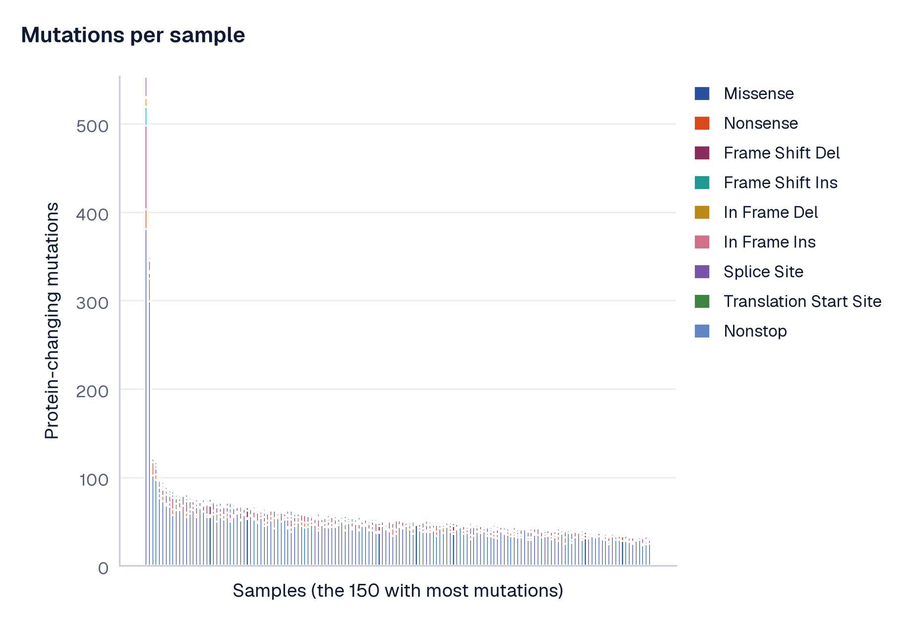
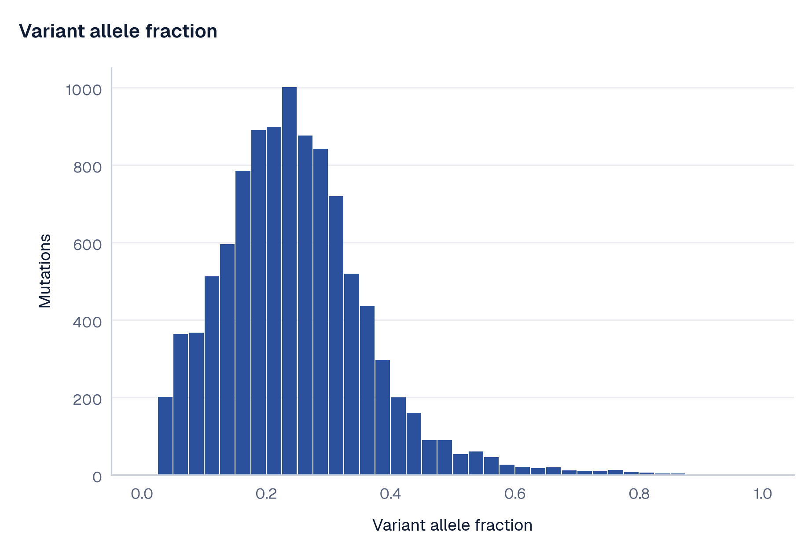
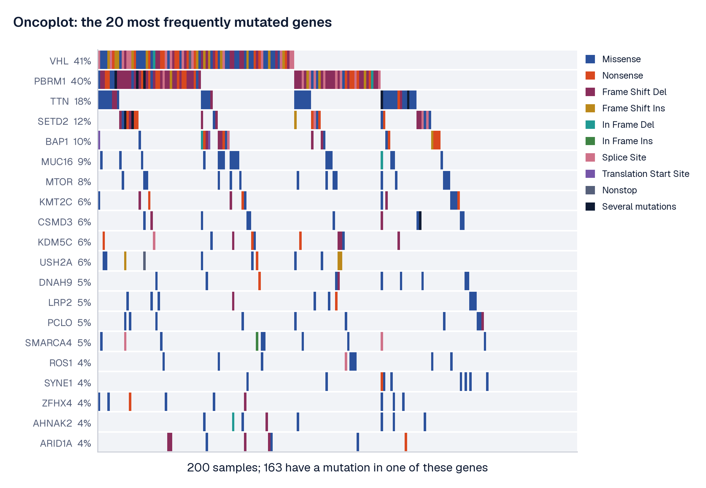
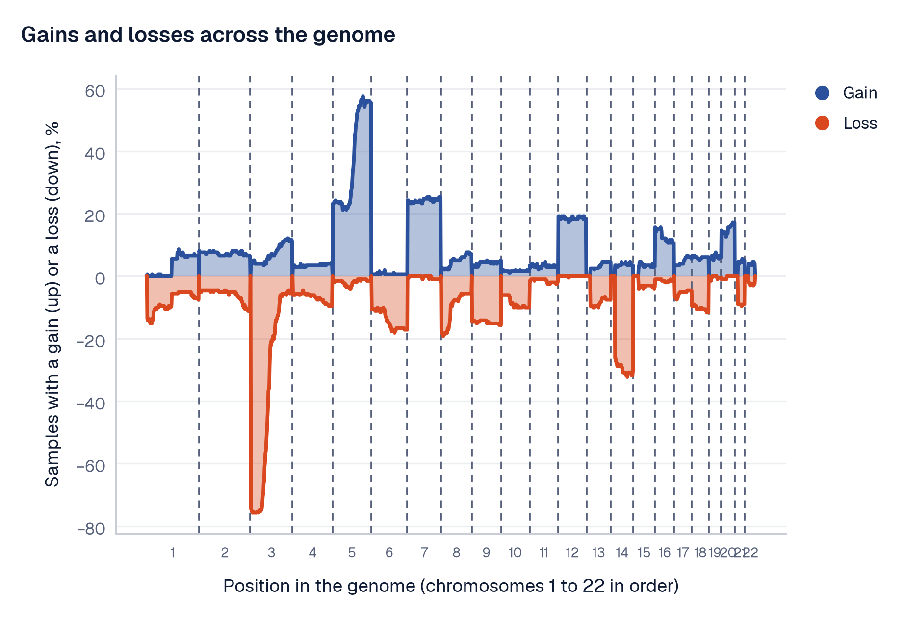
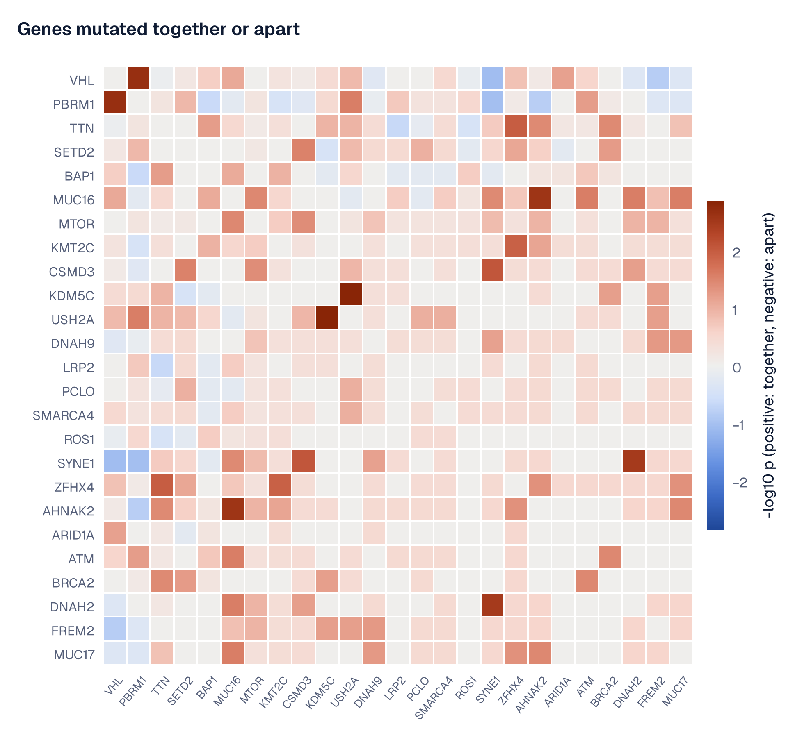
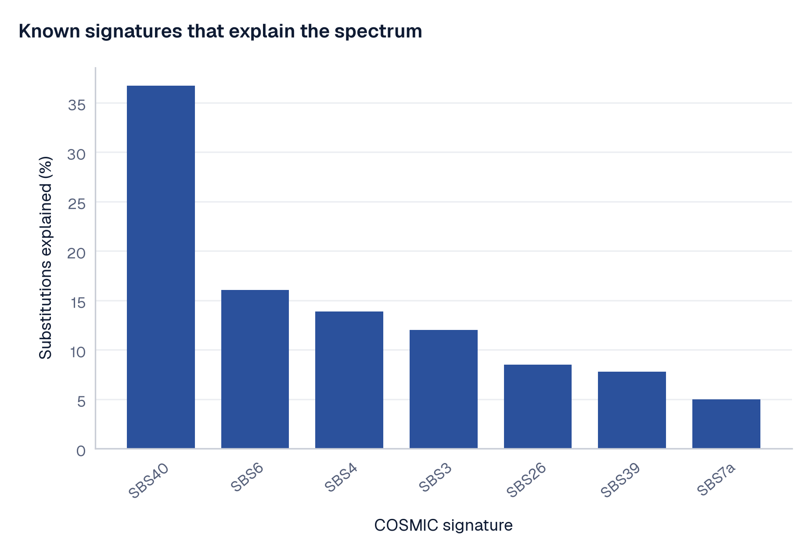
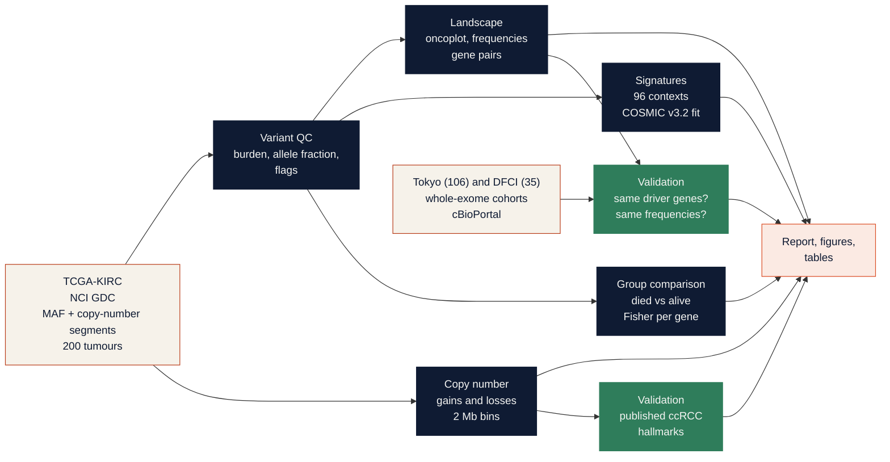
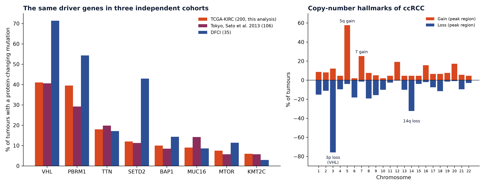

<p align="center"></p>

# The mutations of kidney cancer: a somatic mutation and copy-number analysis in the LSMA Analysis Lab

**Which DNA changes drive clear cell renal cell carcinoma, and how often does each one occur?**

This repository is a worked example from the **LSMA Analysis Lab**, the analysis platform of the [London School of Multiomics & AI](https://lsma.co.uk). The full analysis was run in the lab, without writing code: import of public data, variant quality control, the mutation landscape, mutational signatures, a comparison of patient groups and genome-wide copy number. The report, figures and tables it produced are here, with a validation in independent cohorts.

| | |
|---|---|
| **Data** | TCGA-KIRC (The Cancer Genome Atlas, kidney renal clear cell carcinoma), open-access somatic mutations (MAF) and copy-number segments |
| **Tumours** | 200 primary tumours (10,153 protein-changing mutations; copy number for 198) |
| **Comparison** | patients who had died vs those alive at last follow-up (47 vs 153) |
| **Lab module** | Somatic mutations and copy number (workflow version 1.0.0), genome hg38 |
| **Lab run time** | **1 min 40 s** for the whole analysis (plus 2 min 2 s to import 200 tumours from the GDC) |
| **Validation** | Mutation frequencies in two independent whole-exome cohorts (Tokyo, 106 tumours; DFCI, 35), and the published hallmarks of ccRCC |
| **Result** | **Replicated**: gene frequencies agree with the Tokyo cohort at Spearman ρ = 0.93; the 3p loss peaks at the VHL locus |

---

## Biological question and aim

**Question.** The companion repositories show what clear cell kidney cancer *does*: genes switched on and off, cells, methylation and enhancers. What are the DNA changes that *cause* it: which genes are hit, how often, and which large pieces of chromosome are gained or lost?

**Hypothesis.**
- If loss of *VHL* starts this cancer, *VHL* should be the most frequently mutated gene.
- The short arm of chromosome 3 (3p), which carries *VHL*, *PBRM1*, *SETD2* and *BAP1*, should be the region most often lost.
- Other changes, such as BAP1 mutation, should mark more aggressive disease.

**Aims**
1. Map the protein-changing mutations of 200 tumours and rank the genes they hit.
2. Find genes that tend to be mutated together or apart.
3. Read the mutational signatures: the processes that wrote the mutations.
4. Map gains and losses across the genome from copy-number data.
5. Compare patients who died with those still alive.
6. Check the gene frequencies against independent cohorts.
7. Show each step as it is run in the LSMA Analysis Lab, so a student can repeat it.

---

## Background: the genetics of clear cell kidney cancer

A tumour carries **somatic mutations**: DNA changes acquired during life in the cells that became cancer, not inherited. Some are **drivers** that give the cell a growth advantage; most are **passengers** carried along by chance.

**Clear cell renal cell carcinoma (ccRCC)** has an unusually clear genetic story:
- **Losing *VHL*.** Both copies of the *VHL* gene are lost in most tumours. One copy usually goes with a **deletion of chromosome 3p**, the other by mutation or DNA methylation. That leaves the hypoxia programme switched on (see the [bulk](https://github.com/MultiOmics-Intelligence/lsma-lab-bulk-rnaseq-kidney-cancer-tcga-kirc) and [enhancer](https://github.com/MultiOmics-Intelligence/lsma-lab-chip-seq-kidney-cancer-enhancers) analyses).
- **Other 3p genes.** Three more genes on 3p, *PBRM1*, *SETD2* and *BAP1*, are tumour suppressors that shape the chromatin. With 3p already lost, a single mutation in any of them removes the last working copy.
- **Other copy-number changes.** **Gain of 5q** and **loss of 14q** are frequent.
- **BAP1.** *BAP1* mutations are linked to higher-grade tumours and worse survival.

---

## Key findings

1. **VHL and PBRM1 dominate** (Figure 1). *VHL* is mutated in **41%** of tumours and *PBRM1* in **40%**, followed by *SETD2* (12%), *BAP1* (10%), *MTOR* (7.5%) and *KDM5C* (5.5%).
   - Most *VHL* and *PBRM1* mutations are truncating (nonsense, frameshift, splice site), the pattern of tumour suppressors whose loss matters.
   - *TTN*, *MUC16* and *CSMD3* are frequent because they are very long genes. They are almost certainly passengers.
2. **VHL and PBRM1 are mutated together** more often than chance (43 tumours; odds ratio 2.5, adjusted p = 0.045; Figure 3), in line with the step-wise loss of 3p genes.
3. **Chromosome 3p is the most frequently lost region** (Figure 4).
   - The most often lost 2 Mb stretch, lost in **76%** of tumours, lies at chr3:8–12 Mb, **the region that holds *VHL*** (about 10.1 Mb).
   - Other frequent changes: **5q gain** (up to 58%), **14q loss** (32%), **chromosome 7 gain** (25%), and losses on 6q and 9p.
   - The median tumour has 12% of its genome altered.
4. **A low mutation burden.** The median is 47 protein-changing mutations per tumour (1.2 per megabase). Kidney cancers are not driven by a large number of mutations.
5. **Signatures** (Figure 8). The largest share of substitutions fits **SBS40** (37%), a flat signature typical of kidney cancer in pan-cancer studies. Smaller shares fit other signatures; see the caution under Limitations.
6. **Patients who died vs alive** (Figure 6).
   - Only *ZFHX4* passes correction (15% vs 1%, adjusted p = 0.03), from small numbers (7 vs 2 patients). It needs independent confirmation.
   - *BAP1* is more frequent in patients who died (17% vs 8%, odds ratio 2.4), in the expected direction but not significant with 47 deaths.

Evidence labels from the lab: frequencies and copy number are *exploratory*; gene-pair and group tests are *statistically supported*; signature causes are *biological interpretation*.

---

## Quality control

Somatic mutation data are checked before any biology:

| Check | Result |
|---|---|
| Mutations per tumour | median 47, maximum 554 (Figure QC1) |
| Unusually high mutation counts | TCGA-B0-4698 and TCGA-B0-5098 flagged, because they could dominate frequencies and signatures |
| Variant allele fraction | median 0.24, as expected for heterozygous mutations in tumours mixed with normal cells (Figure QC4) |
| Mutation burden | 1.2 per megabase |
| Transitions to transversions | 0.99 |
| Missing data | none: every tumour has at least one protein-changing mutation |
| Copy-number segments | 22,675 in 198 tumours; 16,746 used after requiring at least 10 markers |

The variant types (QC2), substitution classes (QC3), burden per tumour (QC5) and variant classes (QC6) are in [`figures/`](figures). No PCA is shown: mutation calls are too sparse for it (most genes are mutated in fewer than 1% of tumours), so the lab uses the oncoplot and gene frequencies instead.

| | |
|---|---|
|  **QC1.** Protein-changing mutations per tumour. |  **QC4.** Variant allele fraction. |

---

## Figures

| | |
|---|---|
|  **Figure 1.** Oncoplot: the 20 most frequently mutated genes across the 200 tumours, coloured by type of mutation. |  **Figure 4.** Gains and losses across the genome: the 3p loss and 5q gain stand out. |
|  **Figure 3.** Genes mutated together or apart. |  **Figure 8.** Known signatures fitted to the cohort's substitutions. |

All figures are in [`figures/`](figures), as PNG (300 dpi) and vector PDF:

| File | What it shows |
|---|---|
| 01 | Oncoplot |
| 02 | Gene frequencies |
| 03 | Gene pairs |
| 04 | Copy number across the genome |
| 05 | Genome altered per tumour |
| 06 | Died vs alive comparison |
| 07 | Substitution spectrum |
| 08 | Signatures |
| qc-* | Quality control |

## The full report

The lab's own report covers every stage: what was done, why, the checks, the results and their limits. It's available as a [**PDF**](report/LSMA-Analysis-Lab-report-kidney-cancer-somatic-mutations.pdf) or as [**HTML**](report/LSMA-Analysis-Lab-report-kidney-cancer-somatic-mutations.html) (download it and open it in a browser for the interactive version).

## Summary tables ([`results/`](results))

| File | Contents |
|---|---|
| `gene_mutation_summary.tsv` | Every mutated gene: mutations by class, tumours mutated and percentage |
| `gene_pairs_together_or_apart.tsv` | Pairs of frequent genes: co-occurrence counts, odds ratio, p-values |
| `died_vs_alive_gene_comparison.tsv` | Mutation frequency per gene in patients who died vs alive, with Fisher's test |
| `copy_number_by_chromosome.tsv` | Mean and peak percentage of tumours with a gain or loss on each chromosome |
| `copy_number_regions_2mb.tsv` | Gain and loss frequency for every 2 Mb region |
| `mutational_signatures_cohort.tsv` | The cohort's signature fit |
| `mutations_per_sample.tsv` | Mutations per tumour |

---

## Workflow



## How it was done

Every step below is a stage in the LSMA Analysis Lab, run with the settings in [`settings/analysis-settings.json`](settings/analysis-settings.json).

1. **Data import.**
   - The study was found in the lab's public data search and imported from the NCI Genomic Data Commons: 200 primary tumours.
   - Each comes with its open-access somatic mutation file (MAF, GRCh38) and copy-number segments, plus the clinical sheet (sex, age, stage, vital status, survival).
2. **Variant QC.** Mutations were used as supplied by the GDC pipeline. The lab measured mutations per tumour, burden per megabase (38 Mb capture), allele fractions and substitution classes, and flagged tumours with far more mutations than the rest.
3. **Landscape.**
   - Oncoplot and frequencies of the most frequently mutated genes (maftools).
   - Co-occurrence and mutual exclusivity for pairs of frequent genes: Fisher's exact test, Benjamini–Hochberg.
4. **Signatures.** The 96 trinucleotide contexts of all substitutions (maftools) were fitted to COSMIC v3.2 signatures (MutationalPatterns, strict refit). Tumours with at least 50 substitutions were also fitted one by one.
5. **Group comparison.** Patients who had died vs those alive at last follow-up, per gene with at least 5 mutated tumours: Fisher's exact test, Benjamini–Hochberg.
6. **Copy number.** Segment log2 ratios: a gain above 0.2, a loss below −0.2, segments with at least 10 markers, summarised in 2 Mb bins. This is a frequency map; recurrence is not tested (GISTIC is not run).

**Software:** R 4.5.2 and Bioconductor 3.21, with maftools, MutationalPatterns and BSgenome hg38, in the versions listed in the settings file.

---

## Validation

### 1. Independent cohorts
The mutation frequencies were compared with two independent whole-exome studies of ccRCC on cBioPortal, from different patients, hospitals and countries:
- **Tokyo:** Sato et al., *Nature Genetics* 2013, 106 tumours.
- **DFCI:** 35 tumours.

| Gene | TCGA-KIRC (this analysis, 200) | Tokyo (106) | DFCI (35) |
|---|---|---|---|
| **VHL** | **41.0%** | **40.6%** | 71.4% |
| **PBRM1** | **39.5%** | 29.2% | 54.3% |
| **SETD2** | **12.0%** | 11.3% | 42.9% |
| **BAP1** | **10.0%** | 8.5% | 14.3% |
| MTOR | 7.5% | 5.7% | 11.4% |
| KDM5C | 5.5% | 3.8% | 20.0% |
| TP53 | 3.5% | 2.8% | 5.7% |
| PIK3CA | 2.0% | 4.7% | 2.9% |

Across the 20 genes compared, the frequencies agree with Tokyo at **Spearman ρ = 0.93** and with DFCI at **ρ = 0.84**. The same genes lead in every cohort, in nearly the same order (Figure V1, left).
- **DFCI's frequencies are higher overall.** That cohort is small, and its study design and depth differ.
- **Two more cohorts were left out.** The BGI and IRC ccRCC cohorts on cBioPortal were checked but not used. Their public mutation lists report no *PBRM1* (BGI) or no *TTN* (IRC) mutations at all, which suggests they cover only selected genes. Their numbers are still in the table for transparency: [`validation/mutation_frequencies_tcga_vs_independent.tsv`](validation/mutation_frequencies_tcga_vs_independent.tsv).

### 2. The published hallmarks of ccRCC
- **3p loss:** the most frequent change in ccRCC. Here it peaks at the *VHL* locus (76%).
- **5q gain and 14q loss:** the next hallmarks. Here 58% and 32%.
- ***VHL*, *PBRM1*, *SETD2*, *BAP1*:** the four most mutated true drivers, as reported by the TCGA consortium (Nature 2013) and Sato et al. 2013. Here they are the top four genes once the long passenger gene *TTN* is set aside.



**Figure V1.**
- **Left:** mutation frequency of the top genes in TCGA-KIRC and the two independent cohorts.
- **Right:** peak frequency of gains and losses on each chromosome, with the ccRCC hallmarks marked.

**Verdict: replicated.**

---

## Limitations

- ***VHL* is under-counted by mutations alone.** It is also silenced by promoter methylation and lost through deletion. The 41% here counts mutations only, which is why studies that combine all three report higher inactivation rates.
- **Signatures from few mutations.**
  - With a median of about 50 substitutions per tumour, signature fitting is uncertain.
  - The dominant SBS40 is the expected kidney signature. The smaller fits (SBS6 mismatch repair, SBS3 BRCA, SBS7a ultraviolet light, SBS4 tobacco) should not be read as evidence of those processes in these tumours.
- **The survival comparison is crude.** "Died vs alive at last follow-up" ignores how long each patient was followed and their stage. A Cox model on survival time, adjusted for stage, is the proper test; the lab's *Ask the data* tool can run one per gene. *ZFHX4* rests on 7 vs 2 patients.
- **Copy number is a frequency map, not a recurrence test.** Arm-level frequencies depend on the ±0.2 thresholds and on tumour purity.
- **A teaching example, not clinical advice.** These results are for education and must not be used to diagnose or treat anyone.

---

## Repository structure

```
lsma-lab-somatic-mutations-kidney-cancer-tcga-kirc/
├── README.md                  this case study
├── LICENSE                    CC BY 4.0
├── assets/
│   └── lsma-lab-kidney-mutations-banner.svg     animated banner
├── report/                    the LSMA Analysis Lab's full report
│   ├── LSMA-Analysis-Lab-report-kidney-cancer-somatic-mutations.pdf
│   └── LSMA-Analysis-Lab-report-kidney-cancer-somatic-mutations.html
├── figures/                   key figures, PNG (300 dpi) and vector PDF
│   ├── 01-oncoplot ... 08-signature_contributions
│   └── qc-*                                     variant quality control
├── results/                   summary tables (tab-separated)
│   ├── gene_mutation_summary.tsv
│   ├── gene_pairs_together_or_apart.tsv
│   ├── died_vs_alive_gene_comparison.tsv
│   ├── copy_number_by_chromosome.tsv
│   ├── copy_number_regions_2mb.tsv
│   ├── mutational_signatures_cohort.tsv
│   └── mutations_per_sample.tsv
├── validation/                independent cohorts and the ccRCC hallmarks
│   ├── validation-drivers-and-copy-number.png / .pdf
│   └── mutation_frequencies_tcga_vs_independent.tsv
└── settings/
    └── analysis-settings.json           every parameter and software version
```

## Why we share this analysis

This is one of a series of worked examples from the **LSMA Analysis Lab**, published openly for five reasons:

- **To show what the lab does, on real data.** Each repository takes one public dataset through one lab module, from import to report, and shows every step, figure and setting. Nothing is hidden or polished after the fact: the report here is the one the lab produced.
- **To teach a complete analysis, not just a result.** Students see the parts that are usually skipped: quality control, the choice of statistics, an independent validation, and an honest list of limitations.
- **To earn trust by checking known biology first.** These analyses deliberately reproduce findings that are already well established, such as the hypoxia programme and the Warburg switch in kidney cancer. A method that gets the known answers right can be trusted with new questions.
- **To keep testing our own tools.** Every example is a real-world test of the lab. Running public data from start to finish shows what works and what needs fixing, and the fixes go back into the lab for every student. Improvements from this series so far: a more reliable import from NCBI GEO, automatic choice of the right cell-type markers for each tissue in single-cell analysis, and removal of sex-chromosome probes and a more robust DIABLO model in multi-omics.
- **To make the work open and repeatable.** The data are public, every parameter and software version is listed, and diploma students can repeat the same analysis in the lab themselves.

The series follows one cancer, clear cell kidney cancer, through every layer: genes, single cells, DNA methylation, enhancers, mutations, proteins, metabolites and lipids, and all of them together in the [multi-omics analysis](https://github.com/MultiOmics-Intelligence/lsma-lab-multi-omics-kidney-cancer-tcga-kirc). Each repository links to the others.

These examples are for education and must not be used for medical decisions.

## Data source and credits

- **Data:**
  - The Cancer Genome Atlas (TCGA-KIRC), open-access masked somatic mutations and copy-number segments from the [NCI Genomic Data Commons](https://portal.gdc.cancer.gov/projects/TCGA-KIRC), under the [GDC data use policies](https://gdc.cancer.gov/access-data/data-access-processes-and-tools).
  - Independent cohorts from [cBioPortal](https://www.cbioportal.org): *Renal Clear Cell Carcinoma (UTokyo, Nat Genet 2013)* and *Clear Cell Renal Cell Carcinoma (DFCI, Science 2019)*.
  - No raw data are copied into this repository.
- **Reference studies:**
  - Cancer Genome Atlas Research Network. Comprehensive molecular characterization of clear cell renal cell carcinoma. *Nature* 2013;499:43–49.
  - Sato Y, Yoshizato T, Shiraishi Y, et al. Integrated molecular analysis of clear-cell renal cell carcinoma. *Nature Genetics* 2013;45:860–867.
- **Methods:**
  - Mayakonda et al., *Genome Research* 2018 (maftools)
  - Blokzijl et al., *Genome Medicine* 2018 and Manders et al., *BMC Genomics* 2022 (MutationalPatterns)
  - Alexandrov et al., *Nature* 2020 (COSMIC mutational signatures)
- **Companion analyses** (same cancer):
  - [bulk RNA-seq](https://github.com/MultiOmics-Intelligence/lsma-lab-bulk-rnaseq-kidney-cancer-tcga-kirc)
  - [single-cell RNA-seq](https://github.com/MultiOmics-Intelligence/lsma-lab-single-cell-kidney-cancer-ccrcc)
  - [DNA methylation](https://github.com/MultiOmics-Intelligence/lsma-lab-dna-methylation-kidney-cancer-tcga-kirc)
  - [active enhancers](https://github.com/MultiOmics-Intelligence/lsma-lab-chip-seq-kidney-cancer-enhancers)
  - [proteomics](https://github.com/MultiOmics-Intelligence/lsma-lab-proteomics-kidney-cancer-cptac)
  - [metabolomics](https://github.com/MultiOmics-Intelligence/lsma-lab-metabolomics-kidney-cancer)
  - [lipidomics](https://github.com/MultiOmics-Intelligence/lsma-lab-lipidomics-kidney-cancer)
  - [multi-omics](https://github.com/MultiOmics-Intelligence/lsma-lab-multi-omics-kidney-cancer-tcga-kirc)

## Run it yourself

Diploma students of the London School of Multiomics & AI can repeat this analysis in the **LSMA Analysis Lab**:
1. **Public data** → TCGA → *TCGA-KIRC* → Somatic mutations and copy number.
2. 200 primary tumours.
3. Run **Somatic mutations** with the comparison on `vital_status` and copy number switched on.

Find out more about the diplomas at [lsma.co.uk](https://lsma.co.uk).

## Licence

The text, figures and tables in this repository are shared under [Creative Commons Attribution 4.0 (CC BY 4.0)](https://creativecommons.org/licenses/by/4.0/): you may reuse them with credit to the London School of Multiomics & AI. TCGA and cBioPortal data remain under their own terms.

---

**Dr. Anas Alzaeem**, Academic Director, London School of Multiomics & AI


